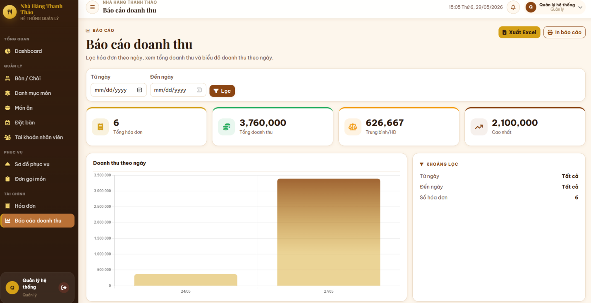
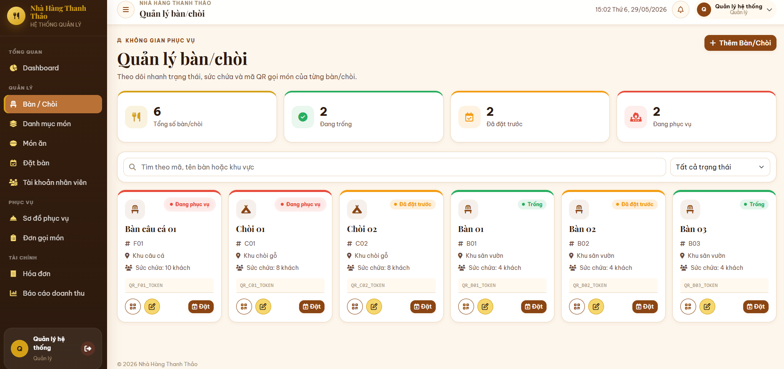
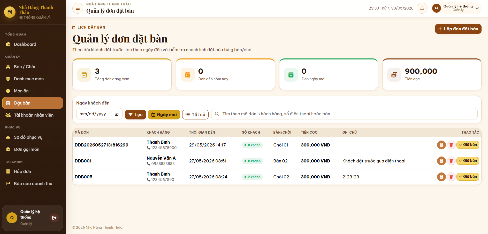
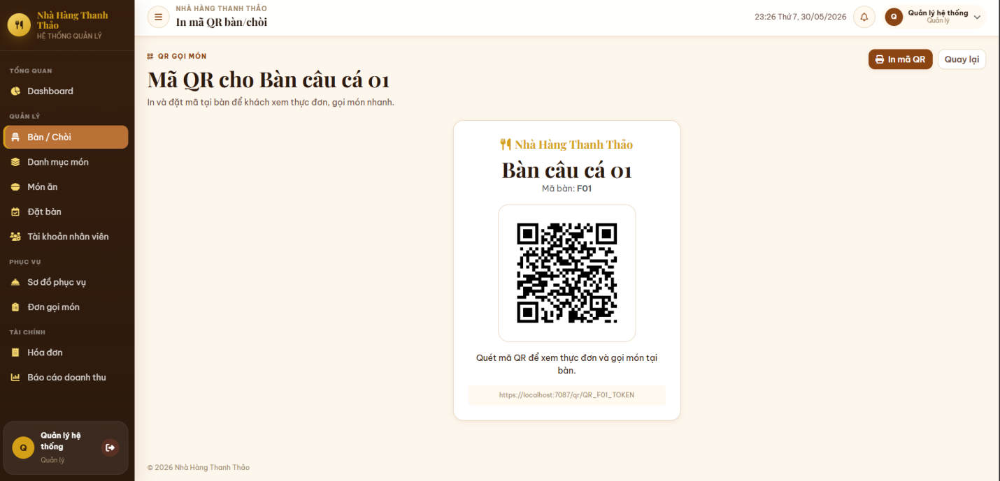
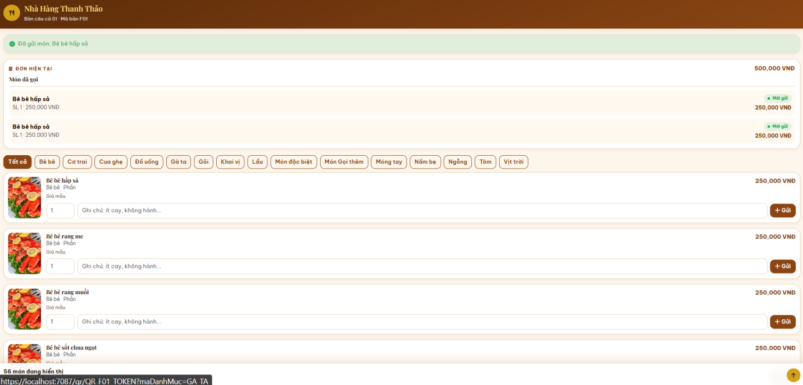
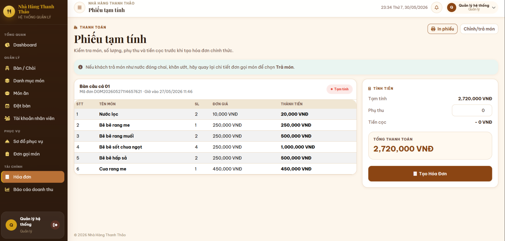

# Hệ thống thông tin quản lý bán hàng và phục vụ Nhà hàng sinh thái Thanh Thảo

<p align="center">
  
</p>

<p align="center">
  <strong>Dự án học tập môn Công nghệ phần mềm</strong><br>
  Ứng dụng web hỗ trợ số hóa quy trình đặt bàn, gọi món, phục vụ, thanh toán và theo dõi doanh thu tại nhà hàng.
</p>

---

## Giới thiệu

**Hệ thống thông tin quản lý bán hàng và phục vụ Nhà hàng sinh thái Thanh Thảo** được xây dựng nhằm hỗ trợ quản lý các nghiệp vụ vận hành nhà hàng trên một hệ thống tập trung, thay thế một phần quy trình ghi chép thủ công.

Dự án mô phỏng quy trình từ lúc khách đặt bàn, quét mã QR để xem thực đơn và gọi món, nhân viên/bếp tiếp nhận yêu cầu, cho đến khi thanh toán và tổng hợp doanh thu.

## Công nghệ sử dụng

| Thành phần | Công nghệ |
|---|---|
| Ngôn ngữ lập trình | C# |
| Framework | ASP.NET Core MVC |
| Giao diện | Razor View, Bootstrap, CSS, JavaScript |
| Truy cập dữ liệu | Entity Framework Core |
| Cơ sở dữ liệu | Microsoft SQL Server |
| Kiến trúc xử lý | Controller, Service, Repository, Unit of Work |

## Chức năng chính

### 1. Quản lý bàn/chòi và đặt bàn
- Quản lý thông tin bàn/chòi, khu vực, sức chứa, mã QR và trạng thái sử dụng.
- Ghi nhận thông tin khách đặt bàn, thời gian đến, số lượng khách, tiền cọc và ghi chú.
- Lập và in phiếu xác nhận đặt bàn.
- Theo dõi các trạng thái: Trống, Đang phục vụ và Đã đặt trước.

### 2. Quản lý thực đơn và gọi món
- Quản lý danh mục món ăn và thông tin món ăn.
- Khách hàng quét mã QR tại bàn/chòi để xem thực đơn điện tử.
- Hỗ trợ khách tự gọi món qua QR hoặc nhân viên nhập món.
- Theo dõi món đã gọi, hỗ trợ gọi thêm và điều chỉnh món trước khi thanh toán.
- In phiếu chế biến; phiếu bổ sung chỉ gồm các món mới chưa chuyển bếp.

### 3. Thanh toán và hóa đơn
- Lập phiếu tạm tính để khách kiểm tra trước khi thanh toán.
- Tính tổng tiền món, phụ thu và khấu trừ tiền cọc (nếu có).
- Tạo, in và lưu hóa đơn thanh toán.
- Cập nhật trạng thái đơn gọi món và giải phóng bàn/chòi sau khi thanh toán.

### 4. Tài khoản và phân quyền
- Đăng nhập cho các vai trò nội bộ.
- Phân quyền Quản lý và Nhân viên phục vụ.
- Quản lý tài khoản nhân viên; hỗ trợ khóa/mở khóa tài khoản.
- Khách hàng truy cập thực đơn và gọi món qua QR mà không cần tài khoản nội bộ.

### 5. Báo cáo và thống kê
- Lọc báo cáo doanh thu theo khoảng thời gian.
- Thống kê số hóa đơn, tổng doanh thu, doanh thu trung bình và hóa đơn có giá trị cao nhất.
- Hiển thị biểu đồ doanh thu theo ngày.
- Xuất báo cáo doanh thu ra Excel.

## Một số giao diện

### Sơ đồ bàn/chòi
<p align="center">
  
</p>

### Quản lý đặt bàn
<p align="center">
  
</p>

### Mã QR bàn/chòi
<p align="center">
  
</p>

### Quản lý thực đơn
<p align="center">
  
</p>

### Phiếu tạm tính
<p align="center">
  
</p>

### Báo cáo doanh thu
<p align="center">
  
</p>

## Cài đặt và chạy dự án

> Các bước dưới đây là hướng dẫn tổng quát theo quy trình triển khai trong báo cáo. Tên solution/project và đường dẫn script SQL cần đối chiếu với cấu trúc mã nguồn thực tế.

### Yêu cầu
- .NET SDK tương thích với phiên bản ASP.NET Core của dự án.
- Microsoft SQL Server.
- Visual Studio hoặc .NET CLI.

### Các bước thực hiện
1. Clone repository về máy:
   ```bash
   git clone https://github.com/thanhbinh-io/HeThongBanHangVaPhucVuNhaHang.git
   ```
2. Mở solution bằng Visual Studio hoặc mở thư mục dự án trong IDE.
3. Chuẩn bị SQL Server, tạo database `NhaHangThanhThaoDB` và chạy script tạo cơ sở dữ liệu/dữ liệu mẫu (nếu repository có cung cấp).
4. Cấu hình chuỗi kết nối `DefaultConnection` trong `appsettings.json` theo SQL Server trên máy của bạn.
5. Khôi phục các package và chạy ứng dụng:
   ```bash
   dotnet restore
   dotnet run
   ```
6. Mở địa chỉ localhost được hiển thị trong terminal hoặc IDE.

**Lưu ý:** Không đưa mật khẩu, chuỗi kết nối chứa thông tin đăng nhập thật hoặc dữ liệu cá nhân lên repository công khai. Hãy dùng cấu hình local riêng khi cần.

## Cấu trúc tài liệu

- `docs/images/`: Một số ảnh giao diện được trích từ báo cáo dự án.
- Báo cáo phân tích, thiết kế và triển khai: xem file báo cáo Word/PDF trong repository (nếu được bổ sung).

## Thành viên thực hiện

- **Phạm Thanh Bình** — Nhóm trưởng
- **Nguyễn Quốc Khánh**

Dự án được thực hiện trong khuôn khổ bài tập nhóm môn Công nghệ phần mềm, Khoa Công nghệ thông tin, Đại học Nha Trang (2026).

---

<p align="center">
  <sub>Educational project · ASP.NET Core MVC · SQL Server</sub>
</p>

